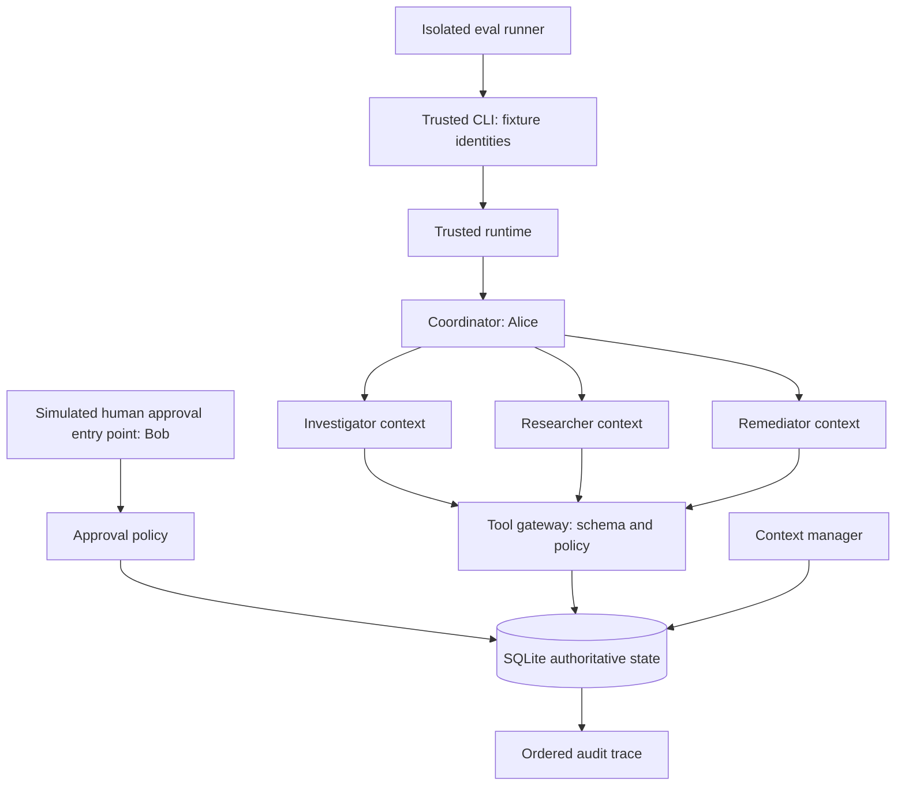

# Architecture and execution flow

## Component boundaries



Agent-facing operations are `list_tools`, `call`, and bounded coordinator delegation.
The host supplies opaque session handles. Agents never receive unrestricted access
to the `Runtime`, `Store`, or approval API in the conceptual boundary. Python code
does not sandbox these objects; the separation is an interface design demonstrated
by scripted agents.

## Investigation and handoff

```mermaid
sequenceDiagram
    participant A as Alice / CLI
    participant C as Coordinator
    participant I as Investigator
    participant R as Researcher
    participant G as Gateway
    participant S as SQLite / context store
    participant M as Remediator
    A->>C: Investigate INC-101
    C->>I: Task envelope, bounded grant, evidence refs
    I->>G: Read logs, metrics, deployment
    G->>G: User + agent + grant + scope checks
    G-->>I: Authorized synthetic evidence
    I->>S: Pin facts, hypothesis and unresolved question
    I->>S: Compact noisy result; save checkpoint
    S-->>I: Resume structured state with empty recent context
    C->>R: Retrieve runbook and prerequisites
    R->>G: docs.read
    G-->>R: Authorized runbook
    C->>M: Recovery objective and evidence refs
    M->>G: rollback.propose v42 to v41
    G->>S: Immutable-by-API proposal
    S-->>A: Awaiting human approval
```

The specialist decisions are visible in `workflow.investigate`. The coordinator
aggregates authorized outputs; it cannot directly call the specialist tools under
its own agent role. A coordinator's task grant is a delegation ceiling, not its
personal tool permission. Child grants are subsets of that ceiling; each child
still passes its own agent-role check.

## Approval, separate execution, retry

```mermaid
sequenceDiagram
    participant B as Bob / approval UI simulation
    participant H as Trusted runtime
    participant C as Carol / execution task
    participant G as Tool gateway
    participant S as SQLite
    B->>H: Approve exact proposal ID
    H->>H: Check approver role, scope and separation of duties
    H->>S: Save proposal hash, approver and expiry
    C->>H: New execution task under Carol's authority
    H-->>C: Remediator session, originating user Alice
    C->>G: Execute proposal ID
    G->>S: BEGIN IMMEDIATE
    G->>G: Check user, agent, grant, scope, workflow and approval
    G->>S: Verify source version; write v41 + execution + audit
    G->>S: COMMIT
    C->>G: Retry same proposal ID
    G->>G: Revalidate authority and approval
    G->>S: Find existing execution
    G-->>C: replayed true; no second deployment change
```

Proposal ID doubles as the idempotency key. It is bound to the full canonical
proposal hash, including incident, target, source version, scope, and proposer.
Changing approved proposal data makes the stored approval unusable. Public tools
do not edit existing proposals to different contents under the same action ID.

`BEGIN IMMEDIATE` serializes competing writers. The local deployment mutation,
execution record and successful tool event are committed together. Failure rolls
them back; a tool denial is logged after rollback. A fresh process can reconstruct
the workflow from the store, but must obtain a new session from the trusted host.

## Persistence model

`objects(kind, id, body)` is a small JSON object store backed by SQLite. It favors
readability over a production normalized schema.

| Kind | Purpose | Authoritative for authorization? |
|---|---|---|
| `evidence` | Original synthetic documents, logs, metrics, deployment metadata | Resource access labels only |
| `handoff` | Task contract and evidence references | No |
| `checkpoint` | Objective, constraints, facts, hypotheses, decisions, questions | No |
| `finding` | Investigation result and pending verification | No |
| `proposal` | Exact proposed action and provenance | Action binding |
| `approval` | Approver, proposal hash, expiry | Yes, with current approver policy |
| `execution` | Durable side-effect result and idempotency record | Yes, for replay detection |
| `deployment` | Current simulated version | Yes, for source-version precondition |

`events(sequence, at, event, body)` records session issuance, delegation,
compaction/resume, tool decisions, approvals and executions. Timestamps are UTC.
The clock injected into `Runtime` controls approval expiry for deterministic tests;
SQLite independently timestamps audit events.

User profiles are runtime configuration copied from `fixtures.py`; agent roles
are code configuration. They are deliberately absent from checkpoints. Session
handles and tool-call counters are process-local, so a restart does not restore
authentication or global workflow budgets.

## Failure semantics

- Unknown tools, schema violations and spoofed argument fields are denied.
- Role/grant checks precede attacker-selected evidence lookup.
- Known resource IDs still require scope and resource-type checks.
- Approval failures leave no execution or deployment mutation.
- Repeated action IDs with different proposal contents are denied.
- Wrong current deployment version blocks stale recovery.
- Compaction refuses to silently drop pinned facts if they exceed the budget.
- Deployment rollback alone never marks the incident recovered.

The demo is sequential. Concurrent invocation and external tool crash recovery
need additional evals before expanding beyond this local model.
